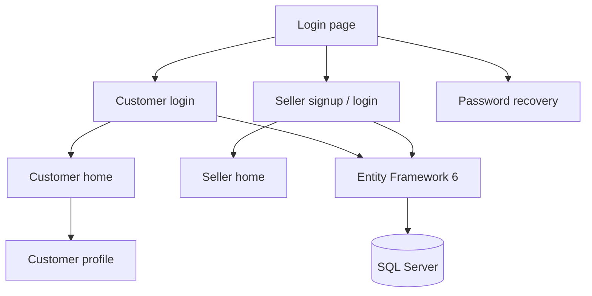

<div align="center">

# Store Desktop Application

### A role-aware WPF authentication experience for customers and sellers

`C#` · `WPF` · `.NET Framework 4.7.2` · `Entity Framework 6` · `SQL Server` · `XAML`

</div>

## Overview

Store Desktop Application is a Windows desktop project that demonstrates account registration, login, password recovery, profile data, and role-specific navigation for customers and sellers. The UI is built with WPF pages and XAML resources, while Entity Framework 6 connects the application to SQL Server.

## Features

- Customer registration and login.
- Seller registration and login flow.
- Role-specific customer and seller home pages.
- Password-recovery form.
- Customer profile page and persisted account data.
- Navigation-based WPF interface with reusable XAML styles.
- Entity Framework database-first model (`.edmx`).

## Application flow



## Main screens

| Screen | Purpose |
|---|---|
| `LoginPage` | Validate account credentials and route users |
| `SignUpPage` | Create a customer account |
| `Seller_Sinup` | Create a seller account |
| `ForgetPassword_page` | Reset stored credentials |
| `Homepage_Customer` | Customer landing experience |
| `HomePage_Seller` | Seller landing experience |
| `CustomerProfilePage` | Review customer profile information |

## Requirements

- Windows 10/11
- Visual Studio 2022 with **.NET desktop development**
- .NET Framework 4.7.2 developer pack
- SQL Server Express or SQL Server

## Run locally

```bash
git clone https://github.com/MostafaMedhat19/Store-Desktop-Project-.git
```

1. Open `Ecommerce.Login/Ecommerce.Login.sln` in Visual Studio.
2. Restore NuGet packages.
3. Create or restore the expected e-commerce database in SQL Server.
4. Update the `Entities` connection string in `Ecommerce.Login/Ecommerce.Login/App.config` for your SQL Server instance.
5. Set `Ecommerce.Login` as the startup project and run it.

> The checked-in connection string references the original development machine. It must be changed before the project can connect on another computer.

## Project structure

```text
Ecommerce.Login/
├── Ecommerce.Login.sln
└── Ecommerce.Login/
    ├── *.xaml / *.xaml.cs       WPF screens and behavior
    ├── Ecommerce_Model.edmx     Entity Framework database model
    ├── App.config               Runtime and database configuration
    └── Resources/               Shared styles and assets
```

## Roadmap

- Hash passwords instead of storing credentials directly.
- Validate forms consistently and provide inline error feedback.
- Separate data access, business logic, and view models using MVVM.
- Add screenshots and a packaged installer.
- Remove `.vs`, `bin`, `obj`, and restored packages from version control.

## Author

[Mostafa Medhat](https://github.com/MostafaMedhat19)
